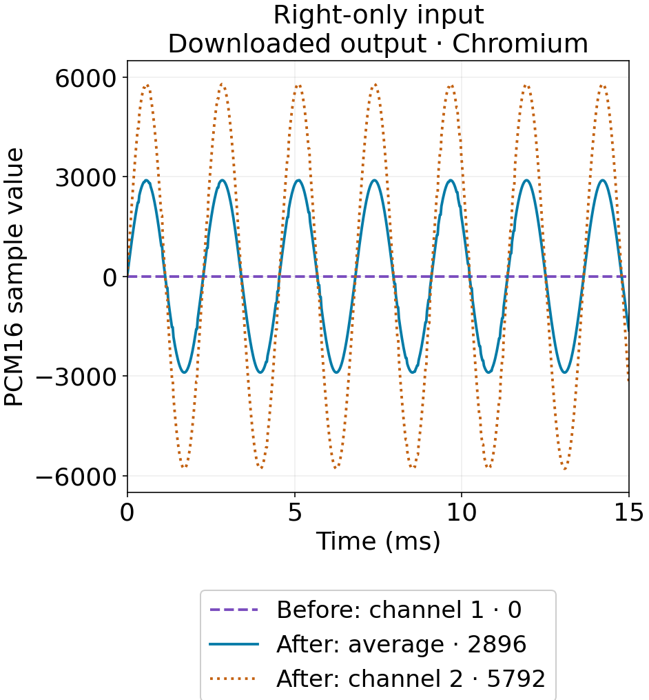
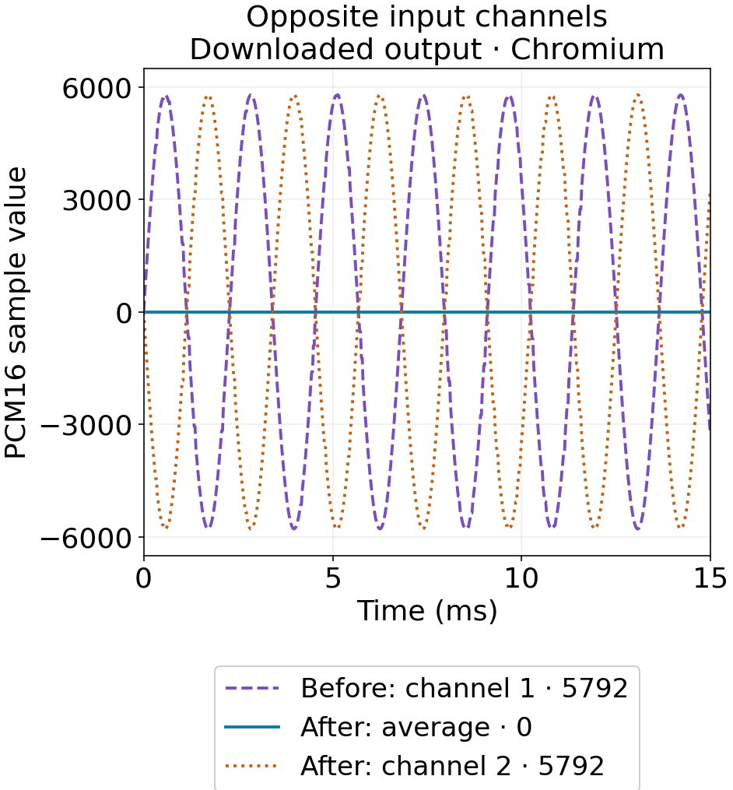

## Two output channels can contain two copies of silence

A WAV with sound only in its right input channel became completely silent after import into Nerulio's SFX generator. Its downloaded output still had two channels. Counting output channels would not have found the problem: the importer read channel 1 and discarded channel 2 before the sound reached the renderer.

The corrected importer averages input channels by default and offers an explicit channel 1 or channel 2 choice. A different input exposes a limit of averaging: equal signals with opposite polarity can cancel. We measured both cases rather than treating a nonzero export as the only success condition.

An AI agent operated the actual UI, measured the worker's imported PCM and independently decoded the downloaded WAVs. This report does not claim listening, separate human review or playback in a game engine.

## Five generated inputs and a controlled project

The inputs are generated test tones, with no external recording or third-party music: 440 Hz, 0.5 seconds, 44,100 Hz PCM16, 22,050 frames and an integer peak of 8,192. They contain one mono channel, a left-only stereo signal, a right-only signal, identical left/right signals, or opposing left/right signals.

Download the [right-only input](/assets/editorial/2026-11-14-sfx-channels/fixed/chromium/right-only.wav), [opposing-channel input](/assets/editorial/2026-11-14-sfx-channels/fixed/chromium/opposite-phase.wav) and exact [project settings](/assets/editorial/2026-11-14-sfx-channels/fixed/chromium/project.json). The project uses seed 1, 44,100 Hz output, master and layer gain 1, center pan, a 20,000 Hz low-pass setting and the soft limiter off. These are SFX-renderer measurements, not an identity audio conversion.

On November 14, 2026 in Korea time, Chromium 153.0.8010.12 and Firefox 155.0 each produced five before-fix and eight after-fix exports: 26 WAVs. Each browser also rejected one mono input when channel 2 was selected. The script checks the actual import choice before proceeding; a typed or displayed setting alone is insufficient.

## Peaks in the downloaded PCM16 WAVs

Every number below is the maximum absolute integer sample across the downloaded WAV. Chromium and Firefox gave the same integer peaks in these conditions. A dash means that choice did not exist in the before-fix UI.

| Input | Import choice | Before fix | After fix |
| --- | --- | ---: | ---: |
| Mono | Default | 5792 | 5792 |
| Left only | Default | 5792 | 2896 |
| Right only | Default | 0 | 2896 |
| Identical L/R | Default | 5792 | 5792 |
| Opposing L/R | Default | 5792 | 0, cancellation notice |
| Right only | Channel 2 | — | 5792 |
| Opposing L/R | Channel 1 | — | 5792 |
| Opposing L/R | Channel 2 | — | 5792 |

Before the fix, Default meant channel 1 only; afterwards it means the channel average. For a right-only stereo input, averaging gives half of the active channel's amplitude. Selecting channel 2 avoids that division. Neither choice restores the original stereo image: a sample layer is one mono voice, which the renderer then pans into its two output channels.

Compare the exact [old silent WAV](/assets/editorial/2026-11-14-sfx-channels/legacy/chromium/right-only-legacy-channel1-output.wav), [new averaged WAV](/assets/editorial/2026-11-14-sfx-channels/fixed/chromium/right-only-mix-output.wav) and [selected-channel WAV](/assets/editorial/2026-11-14-sfx-channels/fixed/chromium/right-only-channel2-output.wav). The graph uses channel 1 of those downloaded files; its legend numbers are full-file peaks.

## Why averaging can still remove a signal

For two channels, this importer uses `(L + R) / 2`. The [W3C Web Audio Recommendation's stereo-to-mono equation](https://www.w3.org/TR/2021/REC-webaudio-20210617/#down-mixing) uses the same average. If R equals −L, their sum is zero. For more than two input channels, Nerulio takes an equal average of all channels; this is not the specification's layout-specific 5.1 downmix.

Browser decoding left a small floating-point residual in the opposing-channel average, about 0.00000384 in the imported mono buffer. The downloaded PCM16 files quantized to zero in both browsers. The UI detects near-total cancellation, shows a notice, and suggests choosing one channel and loading the file again. See the exact [UI capture](/assets/editorial/2026-11-14-sfx-channels/fixed/chromium/opposite-phase-mix.png).

The browsers agreed on these integer peaks, but their decoded samples, RMS values and nonzero file hashes were not identical. For example, the right-only averaged output RMS was 2017.317684 in Chromium and 2017.310990 in Firefox. The separate JSON reports retain those differences.

## An inspection sequence for a silent sample

1. Open [SFX Generator](/en/game/sfx-generator/) and expand Advanced sound controls. Choose Channels to import before loading the file; changing it afterwards applies to the next import.
2. Start with the channel average. Check the Last import note for the decoded input channel count and the applied choice.
3. If the note reports cancellation, choose a populated individual channel and load the same original file again. An absent second channel produces an error instead of silently falling back to channel 1.
4. Export WAV and inspect its decoded sample values as well as its channel count. Listen to the actual file and check it in the destination engine before shipping. Those listening and engine checks were not performed for this report.

If retaining the original left/right placement is required, use a workflow that preserves stereo samples. Imported audio stays in this tool's current session; settings links and saved project JSON do not carry the sample bytes.

## Reproduce and interpret the boundaries

The recorded source commits are [before fix, 0d35653](https://github.com/2009seungbin-stack/my-first-repo/tree/0d356532384eed4722147b226fa6405e71320fee) and [after fix, 3b4180b](https://github.com/2009seungbin-stack/my-first-repo/tree/3b4180be5bdb2580c113a41774cdb3f104847e73). Both datasets record unmodified source. Install that source's Node dependencies, `requirements-test.txt` and Playwright browsers. Run `python tools/editorial/measure-sfx-channels.py --ui legacy --browser chromium` at the old source, or `--ui fixed` at the new source. Repeat with `--browser firefox`. The script owns a temporary local server and writes fresh results under `test-results/` by default.

Each report includes input/output hashes, hashes and levels of the actual worker PCM, project settings and import notices. All output WAVs here contain 22,712 frames, about 0.515 seconds, including the renderer tail; the input contains 22,050 frames. Gains, panning, processing and browser decoding are part of the path. These results establish the channel-loss defect and the measured behavior of these test signals, not sample-identical conversion, perceived loudness or results for every recording. The [evidence manifest](/assets/editorial/2026-11-14-sfx-channels/audit.json) and [method notes](/assets/editorial/2026-11-14-sfx-channels/README.txt) list the published files.
