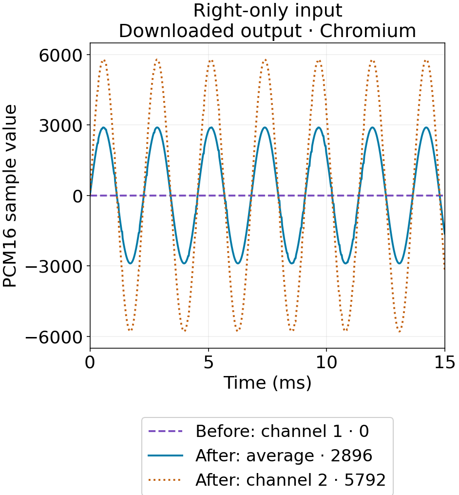
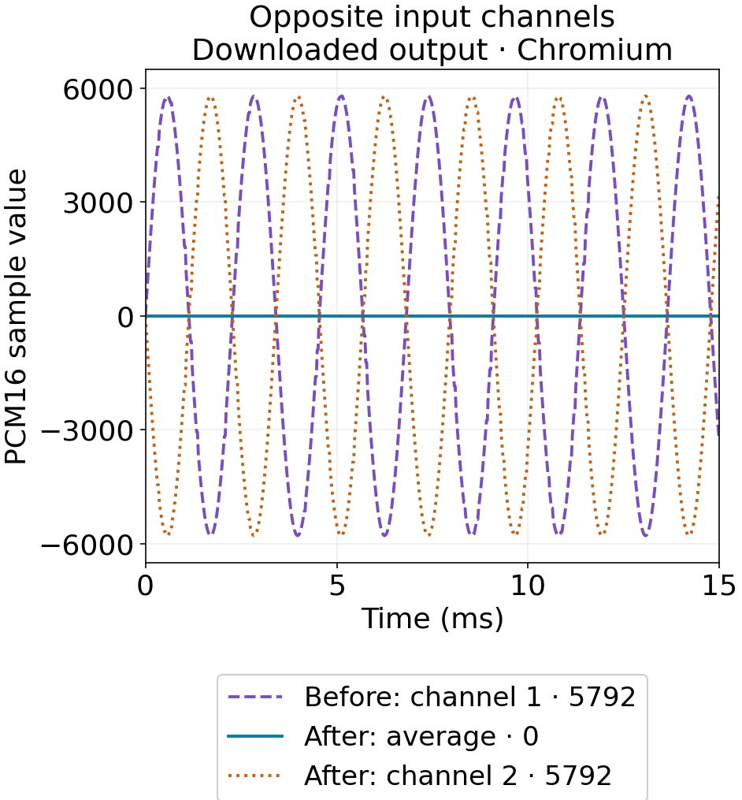

## 출력 채널이 두 개여도 둘 다 무음일 수 있다

오른쪽 채널에만 소리가 있는 WAV를 Nerulio SFX 생성기에 가져왔더니, 내려받은 결과가 완전한 무음이 됐습니다. 출력 WAV의 채널 수는 여전히 두 개였습니다. 원인은 채널 수가 아니라 가져오기 과정이었습니다. 렌더러로 보내기 전에 입력의 첫 번째 채널만 읽고 두 번째 채널을 버렸습니다.

수정한 가져오기는 기본적으로 입력 채널의 평균을 사용하며, 채널 1이나 채널 2를 직접 고를 수도 있습니다. 다만 평균에도 한계가 있습니다. 크기가 같고 극성이 반대인 두 신호는 서로 상쇄됩니다. 이번에는 0이 아닌 출력이 생겼는지만 보지 않고 두 경우를 함께 측정했습니다.

AI 에이전트가 실제 UI를 조작하고, 워커로 전달된 PCM과 내려받은 WAV를 분석해 작성했습니다. 별도의 사람 청음·검토나 게임 엔진 재생 시험을 수행했다고 주장하지 않습니다.

## 직접 만든 입력 5개와 고정한 설정

외부 녹음이나 타인의 음악 없이 테스트 신호를 생성했습니다. 440Hz, 0.5초, 44,100Hz PCM16이며, 22,050프레임과 정수 피크 8,192를 가집니다. 모노 하나, 왼쪽만 있는 스테레오, 오른쪽만 있는 스테레오, 좌우가 같은 신호, 좌우 극성이 반대인 신호를 만들었습니다.

정확한 [오른쪽 전용 입력](/assets/editorial/2026-11-14-sfx-channels/fixed/chromium/right-only.wav), [반대 극성 입력](/assets/editorial/2026-11-14-sfx-channels/fixed/chromium/opposite-phase.wav), [프로젝트 설정](/assets/editorial/2026-11-14-sfx-channels/fixed/chromium/project.json)을 받을 수 있습니다. 시드 1, 출력 44,100Hz, 마스터·레이어 게인 1, 중앙 패닝, 저역 통과 설정 20,000Hz, 소프트 리미터 끔을 사용했습니다. 원본을 그대로 복사하는 포맷 변환이 아니라 SFX 렌더러를 통과한 결과입니다.

한국 시간 2026년 11월 14일, Chromium 153.0.8010.12와 Firefox 155.0에서 각각 수정 전 5개, 수정 후 8개를 내보내 WAV 총 26개를 얻었습니다. 각 브라우저에서 모노 입력에 채널 2를 지정한 경우도 한 번씩 거부됐습니다. 재현 스크립트는 표시된 값뿐 아니라 실제 적용한 가져오기 선택도 확인합니다.

## 내려받은 PCM16 WAV의 피크

아래 수치는 WAV 전체 샘플의 절댓값 중 가장 큰 정수입니다. 이 조건들에서는 두 브라우저의 정수 피크가 같았습니다. 대시는 수정 전 UI에 해당 선택이 없었다는 뜻입니다.

| 입력 | 가져오기 선택 | 수정 전 | 수정 후 |
| --- | --- | ---: | ---: |
| 모노 | 기본값 | 5792 | 5792 |
| 왼쪽만 | 기본값 | 5792 | 2896 |
| 오른쪽만 | 기본값 | 0 | 2896 |
| 좌우 동일 | 기본값 | 5792 | 5792 |
| 좌우 반대 극성 | 기본값 | 5792 | 0, 상쇄 안내 |
| 오른쪽만 | 채널 2 | — | 5792 |
| 좌우 반대 극성 | 채널 1 | — | 5792 |
| 좌우 반대 극성 | 채널 2 | — | 5792 |

기본값은 수정 전에는 채널 1만, 수정 후에는 채널 평균을 뜻합니다. 오른쪽에만 신호가 있는 스테레오를 평균 내면 활성 채널의 진폭이 절반이 됩니다. 채널 2를 직접 고르면 이 나눗셈을 피합니다. 샘플 레이어는 모노 음원 하나로 처리되고, 렌더러가 이를 출력 두 채널로 패닝합니다. 따라서 어느 쪽도 원래 스테레오 공간 배치를 보존하는 기능은 아닙니다.

실제 [이전 무음 WAV](/assets/editorial/2026-11-14-sfx-channels/legacy/chromium/right-only-legacy-channel1-output.wav), [수정 후 평균 WAV](/assets/editorial/2026-11-14-sfx-channels/fixed/chromium/right-only-mix-output.wav), [채널 2 선택 WAV](/assets/editorial/2026-11-14-sfx-channels/fixed/chromium/right-only-channel2-output.wav)를 비교할 수 있습니다. 그래프는 이 파일들의 첫 번째 출력 채널을 그렸으며, 범례 수치는 파일 전체의 피크입니다.

## 평균이 신호를 없애는 경우

두 채널의 평균은 `(L + R) / 2`입니다. [W3C Web Audio 권고안의 스테레오→모노 식](https://www.w3.org/TR/2021/REC-webaudio-20210617/#down-mixing)도 이 평균을 사용합니다. R이 −L이면 합은 0입니다. Nerulio는 입력이 세 채널 이상일 때도 모든 채널을 같은 비중으로 평균 냅니다. 이는 권고안의 5.1 스피커 배치별 다운믹스와는 다릅니다.

반대 극성 입력은 브라우저 디코딩을 거친 뒤 모노 버퍼에 약 0.00000384의 작은 부동소수점 잔차를 남겼습니다. 하지만 내려받은 PCM16 WAV는 두 브라우저 모두 0으로 양자화됐습니다. UI는 거의 전부 상쇄된 상태를 감지해, 한 채널을 고른 뒤 파일을 다시 가져오도록 안내합니다. 정확한 [UI 캡처](/assets/editorial/2026-11-14-sfx-channels/fixed/chromium/opposite-phase-mix.png)도 공개합니다.

정수 피크가 같다고 모든 샘플과 파일이 동일한 것은 아닙니다. 오른쪽 전용 입력의 평균 출력 RMS는 Chromium에서 2017.317684, Firefox에서 2017.310990이었습니다. 0이 아닌 결과의 샘플·해시에도 차이가 있어, 브라우저별 JSON에 따로 남겼습니다.

## 샘플이 무음일 때 확인하는 순서

1. [SFX 생성기](/ko/game/sfx-generator/)에서 고급 사운드 조절을 펼칩니다. 파일을 불러오기 전에 가져올 채널을 고릅니다. 불러온 뒤 선택을 바꾸면 다음 가져오기에 적용됩니다.
2. 전체 채널 평균으로 시작하고, 마지막 가져오기 안내에서 디코딩된 입력 채널 수와 실제 선택을 확인합니다.
3. 상쇄 안내가 나오면 신호가 들어 있는 개별 채널을 고른 뒤 같은 원본 파일을 다시 불러옵니다. 없는 두 번째 채널을 고르면 첫 채널로 몰래 대체하지 않고 오류를 표시합니다.
4. WAV를 내보내 채널 수와 디코딩한 샘플 값을 함께 봅니다. 실제 사용 전에는 파일을 듣고 대상 엔진에서도 확인하세요. 이번 보고서에서는 그 청음·엔진 시험을 수행하지 않았습니다.

원본의 좌우 배치를 유지해야 한다면 스테레오 샘플을 보존하는 작업 흐름을 사용하세요. 이 도구의 가져온 오디오는 현재 세션에만 있으며, 설정 링크와 저장한 프로젝트 JSON에 샘플 바이트가 포함되지는 않습니다.

## 재현 방법과 해석 범위

기록한 소스는 [수정 전 0d35653](https://github.com/2009seungbin-stack/my-first-repo/tree/0d356532384eed4722147b226fa6405e71320fee), [수정 후 3b4180b](https://github.com/2009seungbin-stack/my-first-repo/tree/3b4180be5bdb2580c113a41774cdb3f104847e73)입니다. 두 데이터셋 모두 해당 소스를 수정하지 않은 상태로 기록했습니다. 해당 소스의 Node 의존성, `requirements-test.txt`, Playwright 브라우저를 설치합니다. 이전 소스에서는 `python tools/editorial/measure-sfx-channels.py --ui legacy --browser chromium`, 수정 소스에서는 `--ui fixed`로 실행합니다. `--browser firefox`로도 반복할 수 있습니다. 스크립트가 임시 로컬 서버를 직접 시작·종료하고 기본적으로 `test-results/` 아래에 결과를 씁니다.

각 보고서에 입출력 해시, 실제 워커 PCM의 해시·레벨, 프로젝트 설정, 가져오기 안내가 있습니다. 입력은 22,050프레임이지만 모든 출력 WAV는 렌더러의 여운 구간을 포함해 22,712프레임, 약 0.515초입니다. 게인·패닝·처리·브라우저 디코딩이 모두 경로에 포함됩니다. 이번 결과가 보여 주는 것은 채널 손실 오류와 이 테스트 신호들의 동작입니다. 샘플 단위 무손실 변환, 지각 음량, 모든 녹음에서 같은 결과를 입증한 것은 아닙니다. 공개 파일은 [증거 목록](/assets/editorial/2026-11-14-sfx-channels/audit.json)과 [측정 메모](/assets/editorial/2026-11-14-sfx-channels/README.txt)에서 확인할 수 있습니다.
