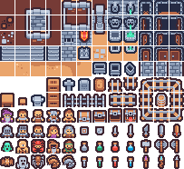

## The result first

Does converting a small PNG to WebP always save space? Both inputs in this test became larger. A 5,339-byte logo produced an 8,832-byte WebP. A 5,533-byte pixel tile sheet produced a 16,556-byte WebP. Automatic mode retained the original PNG in both cases. This is a reproducible case study of small transparent assets, rather than a ranking of formats for photographs or every image type.

An AI agent ran the actual Nerulio encoder in local Chromium and prepared this article. This does not claim separate human visual review or a successful game-engine integration. The files and settings are available for inspection below.

## Inputs and method

The first input is an original geometric logo from our test corpus, released as CC0: a 1,400×400 PNG. The second is the 203×186 PNG tile sheet from Kenney Tiny Dungeon 1.0, whose bundled license is CC0. Two small assets cannot represent photographs, gradients or noisy images.

The run took place on November 14, 2026 in Korea time, using Chromium 153.0.8010.12. Each input went through six settings once: automatic, PNG, WebP, JPEG, a 1KiB target, and a 1KiB target with shrinking allowed. Quality was 0.8. Without a byte target the SSIM floor was 0.965. JPEG used a white background. No maximum width was set. Only the final setting permitted a change in dimensions. The tool treats 1KiB as 1,024 bytes.

The script calls the real `encode` function in `src/image.js` and applies the original-retention rule used by the compression task. It does not substitute another image library. This is not a speed benchmark: there were no repeated timing trials. Other browser versions may produce different files.

## Changing formats at the original dimensions

| Setting | Logo output | Tile-sheet output | Observation |
| --- | ---: | ---: | --- |
| Original | 5,339 B | 5,533 B | Input PNG |
| Automatic, balanced | 5,339 B | 5,533 B | Original retained |
| PNG | 5,339 B | 5,533 B | Original retained |
| WebP, quality 0.8 | 8,832 B | 16,556 B | Larger for both inputs |
| JPEG, quality 0.8 | 25,073 B | 21,710 B | Transparency flattened to white |

Download the [logo PNG](/assets/editorial/2026-11-14-png/logo-input.png), [logo WebP](/assets/editorial/2026-11-14-png/logo-webp.webp), [tile-sheet PNG](/assets/editorial/2026-11-14-png/tiles-input.png) and [tile-sheet WebP](/assets/editorial/2026-11-14-png/tiles-webp.webp) to compare the byte sizes yourself.

Retaining the original is a useful outcome. If a newly encoded candidate is larger at the same dimensions, automatic mode need not hand that candidate back. Explicit WebP or JPEG selection is a format-conversion request, so the task returns that format even when it grows. A destination that requires JPEG may justify conversion, but neither size nor transparency improved in these two JPEG results.

MDN documents the Canvas quality argument for lossy formats such as JPEG and WebP. Setting PNG quality to 80 therefore does not mean a 20% size reduction. The 0.8 setting is not a promise of 80% of the original file size or visual quality.

## What happened at a 1KB target

| Setting | Logo result | Tile-sheet result | Reached 1,024 B? |
| --- | --- | --- | --- |
| Keep dimensions | 5,339 B, 1,400×400 | 5,533 B, 203×186 | Neither; originals retained |
| Allow shrinking | 1,658 B, 102×29 | 1,278 B, 26×24 | Neither |

Allowing shrinking still missed the target and greatly reduced the dimensions. In particular, the entire tile sheet ended up at 26×24. Its original tile sizes and layout no longer survived. If a game expects the original coordinates, preserving the sheet dimensions matters more than simply obtaining fewer bytes.

Open the [shrunken logo](/assets/editorial/2026-11-14-png/logo-target-1k-shrink.webp) and [shrunken tile sheet](/assets/editorial/2026-11-14-png/tiles-target-1k-shrink.webp) alongside the originals. The measured SSIM values were about 0.5925 and 0.1226. This engine metric compares luminance structure on proxies with a maximum side of 512 pixels, taking the worse score from black and white background composites. It is neither full-resolution pixel equality nor a human sharpness rating. When the task retains an original, an encoder candidate's report is separate from the returned file; check `keptByTask` and `outputBytes` in the JSON too.

## A practical order for your own assets

1. Start with automatic format and balanced quality in the [image compressor](/en/image/compress/). An original-retained message means the new result did not save space.
2. Select WebP or JPEG explicitly when the destination requires it, then compare actual downloaded sizes. Check the flattened background if the input was transparent.
3. Leave maximum width and shrinking disabled initially for pixel tile sheets and sprite sheets. Changed dimensions require another check of tile and frame coordinates.
4. Check target attainment and output dimensions separately. Entering a target does not guarantee the encoder can meet it.

To reproduce the run, execute `python tools/editorial/measure-compression.py` from the repository root with the same Python Playwright setup used by the browser tests. The [full JSON record](/assets/editorial/2026-11-14-png/measurements.json) includes SHA-256 hashes, settings and every candidate. Its single-run `elapsedMs` values are diagnostic data, not a speed ranking.

For these two inputs, changing format solely to make an already small transparent PNG smaller was unhelpful. Compare actual bytes, dimensions and transparency. Retain the original when the measured result offers no size benefit.
