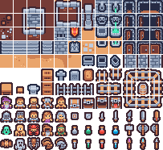

## 먼저 확인한 결과

작은 PNG를 WebP로 바꾸면 항상 줄어들까요? 이번 두 입력에서는 반대였습니다. 5,339바이트 로고를 WebP로 내보내자 8,832바이트가 됐고, 5,533바이트 픽셀 타일셋은 16,556바이트가 됐습니다. 자동 모드는 두 파일 모두 원본 PNG를 유지했습니다. 이 글은 사진이나 모든 이미지 형식의 순위를 정하는 벤치마크가 아닙니다. 이미 작은 투명 에셋에서 형식을 바꾸거나 목표 용량을 강제할 때 무엇을 확인해야 하는지 보여 주는 재현 기록입니다.

AI 에이전트가 로컬 Chromium에서 실제 Nerulio 압축 엔진을 실행하고 이 글을 작성했습니다. 별도 사람의 육안 검수나 게임 엔진 실사용 결과를 뜻하지 않습니다. 수치와 파일은 아래에서 직접 확인할 수 있습니다.

## 입력과 조건

첫 입력은 테스트용으로 직접 만든 기하학 로고입니다. 1,400×400 PNG이며 테스트 코퍼스에서 CC0로 공개한 파일입니다. 둘째 입력은 Kenney의 Tiny Dungeon 1.0 타일셋입니다. 203×186 PNG이며 동봉 라이선스는 CC0입니다. 작은 그림 두 개만 사용했으므로 사진·그라데이션·노이즈가 많은 이미지로 결과를 일반화할 수 없습니다.

2026년 11월 14일 한국시간에 Chromium 153.0.8010.12로 실행했습니다. 동일 입력마다 자동·PNG·WebP·JPEG·1KiB 목표·축소 허용 1KiB 목표를 한 번씩 실행해 총 12개 결과를 얻었습니다. 품질은 0.8, 목표 용량이 없을 때의 SSIM 기준은 0.965, JPEG 배경은 흰색입니다. 최대 너비는 지정하지 않았고, 마지막 조건만 해상도 축소를 허용했습니다. 1KiB는 이 도구에서 1,024바이트로 계산합니다.

실제 엔진인 `src/image.js`의 `encode`를 호출하고, 작업 화면의 원본 유지 규칙을 적용했습니다. 다른 이미지 라이브러리로 대신 인코딩한 수치가 아닙니다. 시간 측정을 반복하지 않았으므로 처리 속도를 비교하지 않습니다. 브라우저가 바뀌면 인코딩 결과도 달라질 수 있습니다.

## 같은 해상도에서 형식만 바꾼 결과

| 조건 | 로고 출력 | 타일셋 출력 | 확인할 점 |
| --- | ---: | ---: | --- |
| 원본 | 5,339 B | 5,533 B | 비교 기준 PNG |
| 자동, 균형 품질 | 5,339 B | 5,533 B | 원본 유지 |
| PNG | 5,339 B | 5,533 B | 원본 유지 |
| WebP, 품질 0.8 | 8,832 B | 16,556 B | 두 입력 모두 원본보다 큼 |
| JPEG, 품질 0.8 | 25,073 B | 21,710 B | 투명 영역을 흰색으로 합침 |

직접 비교하려면 [로고 PNG](/assets/editorial/2026-11-14-png/logo-input.png), [로고 WebP](/assets/editorial/2026-11-14-png/logo-webp.webp), [타일셋 PNG](/assets/editorial/2026-11-14-png/tiles-input.png), [타일셋 WebP](/assets/editorial/2026-11-14-png/tiles-webp.webp)를 각각 저장하세요. 파일 속성의 바이트 단위 크기로 비교하면 됩니다.

자동 모드의 원본 유지는 실패가 아닙니다. 같은 크기로 다시 저장한 후보가 더 크다면 그 후보를 다운로드할 이유가 없습니다. 명시적으로 WebP나 JPEG를 선택하면 형식 변환을 요청한 것이므로, 원본보다 커져도 그 형식으로 내보냅니다. JPEG가 필요한 제출처라면 변환할 수 있지만, 이번 결과에서는 용량 절약과 투명도 유지에 도움이 되지 않았습니다.

MDN이 설명하는 Canvas 품질 매개변수는 JPEG나 WebP 같은 손실 압축 형식에 적용됩니다. 따라서 PNG에 품질 80을 지정했다고 PNG가 20% 줄어드는 것은 아닙니다. 여기서 말하는 0.8도 파일 크기나 원본 품질의 80%를 보장하는 비율이 아닙니다.

## 1KB를 강제하면 생기는 일

| 조건 | 로고 결과 | 타일셋 결과 | 1,024 B 달성 |
| --- | --- | --- | --- |
| 해상도 유지 | 5,339 B, 1,400×400 | 5,533 B, 203×186 | 둘 다 실패, 원본 유지 |
| 축소 허용 | 1,658 B, 102×29 | 1,278 B, 26×24 | 둘 다 실패 |

축소를 허용해도 목표는 달성하지 못했고, 로고와 타일셋의 픽셀 수만 크게 줄었습니다. 특히 타일셋은 시트 전체가 26×24로 줄어 원래 타일 크기와 배치를 유지하지 못합니다. 게임에서 타일 좌표를 그대로 쓰려면 단순한 파일 크기 감소보다 원래 해상도를 보존하는 것이 우선입니다.

[축소된 로고](/assets/editorial/2026-11-14-png/logo-target-1k-shrink.webp)와 [축소된 타일셋](/assets/editorial/2026-11-14-png/tiles-target-1k-shrink.webp)을 열어 원본과 비교할 수 있습니다. 이번에 관찰한 SSIM은 각각 약 0.5925와 0.1226이었습니다. 이 지표는 긴 변 최대 512픽셀의 대리 이미지에서 밝기 구조를 비교하고 검정·흰색 배경 합성 중 낮은 값을 쓰는 엔진 내부 지표입니다. 전체 해상도의 픽셀 일치 검사나 사람이 보는 선명함 점수가 아닙니다. 원본 유지 조건에서는 인코더 후보의 보고서와 실제 반환된 원본을 구분해야 하므로, JSON의 `keptByTask`와 `outputBytes`도 함께 보세요.

## 내 파일에 적용하는 순서

1. [이미지 압축 도구](/ko/image/compress/)에서 먼저 자동·균형 품질로 실행하세요. 원본 유지 안내가 나오면 새 파일이 더 작아지지 않았다는 뜻입니다.
2. 업로드하는 곳에서 특정 형식을 요구할 때만 WebP·JPEG를 명시적으로 선택하고, 실제 다운로드 결과의 용량을 비교하세요. 투명 에셋은 JPEG의 배경 합성 결과도 확인하세요.
3. 픽셀 타일셋이나 스프라이트 시트는 처음에는 최대 너비와 축소 허용을 비워 두세요. 시트 크기를 바꾸면 프레임·타일 좌표도 다시 확인해야 합니다.
4. 목표 용량을 정했다면 결과가 목표를 달성했는지와 출력 해상도를 별도로 확인하세요. 목표를 입력했다고 달성이 보장되지는 않습니다.

로컬에서 다시 측정하려면 저장소 루트에서 `python tools/editorial/measure-compression.py`를 실행하세요. 브라우저 테스트와 같은 Python Playwright 설치가 필요합니다. [전체 JSON 기록](/assets/editorial/2026-11-14-png/measurements.json)에 원본과 결과의 SHA-256, 모든 설정과 후보가 들어 있습니다. 기록의 `elapsedMs`는 한 번 실행한 진단값이므로 속도 순위에 사용하지 마세요.

이 두 입력에서의 판단은 간단합니다. 이미 작은 투명 PNG를 더 작게 만들겠다는 이유만으로 형식을 바꾸지 말고, 원본과 실제 출력의 용량·해상도·투명도를 함께 비교하세요. 실측이 더 작은 결과를 보여 주지 않으면 원본을 유지하는 편이 낫습니다.
