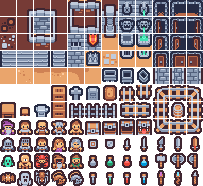
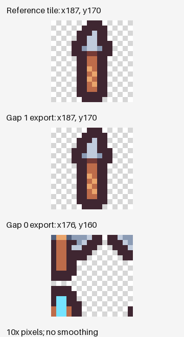

## Check the cut after checking the count

This small tile sheet produced 132 frames with horizontal and vertical gaps of 1px. Setting both gaps to 0px also produced 132 frames. Comparing the outputs with the intended source tiles gave a different result: 132 matches in the reference condition, and one in the zero-gap condition.

An AI agent operated the actual Nerulio UI, inspected the downloaded files and prepared this report. It does not claim separate human visual review or a game-engine execution test. Inputs, applied settings, per-frame checks and reproduction code are available below.

## One input, four exports

The input is the 203×186 PNG from Kenney Tiny Dungeon 1.0. Its bundled license is CC0. The reference grid uses 16×16 cells, no outer margin, and 1px horizontal and vertical gaps: 12 columns and 11 rows. Download the exact [input PNG](/assets/editorial/2026-11-14-sprite-grid/chromium/source.png) to reproduce the comparison.

On November 14, 2026 in Korea time, we exported two conditions in Chromium 153.0.8010.12 and Firefox 155.0, for four exports in total. Both gaps were either 1px or 0px; cell size and outer margin stayed the same. Animations were set to None because these were static tiles. Pack & Export used the Phaser preset and output format.

The script follows the file picker into Studio, changes the controls, applies the cut and downloads the result. It verifies the grid stored in the applied project as well as the typed values. A zero-gap run must actually have both gaps set to zero before it can be recorded.

## Count, coordinates and pixel values

| Browser | X / Y gap | Frames | Coordinate matches | Tile pixel matches |
| --- | --- | ---: | ---: | ---: |
| Chromium 153 | 1px / 1px | 132 | 132 | 132 |
| Chromium 153 | 0px / 0px | 132 | 1 | 1 |
| Firefox 155 | 1px / 1px | 132 | 132 | 132 |
| Firefox 155 | 0px / 0px | 132 | 1 | 1 |

The counts agree because twelve 16px cells fit across 203px in either condition, and eleven fit down 186px. With zero gaps, 11px remain on the right and 10px at the bottom, while the cell count stays unchanged.

With no outer margin, a cell starts at column × (cell width + horizontal gap), row × (cell height + vertical gap). Using zero-based indices, the last cell is column 11, row 10. Its origin is (187, 170) with 1px gaps and (176, 160) with zero gaps. The final cell has drifted 11px horizontally and 10px vertically.

Pillow 12.3.0 reopened each downloaded atlas JSON and PNG. The check reconstructed each frame on its original canvas using its stored region, transparent offset and source size. RGB values were zeroed only where alpha was zero; all remaining RGBA sample values were compared exactly. This is not equality of complete PNG files or a test of colour-management and filtering behavior.

We also checked whether every export preserved the crop selected in the UI. All 132 crops passed in every condition. Preserving a selected crop and selecting the intended tile are separate checks.

## A practical inspection order

1. Open the original in the [sprite sheet slicer](/en/sprite-slicer/). Review cell size, outer margin and both gaps in the Import panel.
2. Inspect the first cell and the final column and row. Increasing drift is a reason to examine spacing. This input's reference settings are 16×16 cells, zero margin and 1×1 gaps.
3. Choose None for animations when you need static tiles, then Apply. Check that a static atlas does not gain an automatic animations file. This tool's Godot SpriteFrames export requires an animation tag; the [Tile workspace](/en/game/tile-lab/) is another starting point for static tile maps.
4. Recheck dimensions and coordinates in the downloaded files. Compare the [1px reference ZIP](/assets/editorial/2026-11-14-sprite-grid/chromium/gap-1-phaser.zip) with the [0px control ZIP](/assets/editorial/2026-11-14-sprite-grid/chromium/gap-0-phaser.zip).

## Original-sheet settings in Godot

Godot's TileSetAtlasSource documentation describes tile region size, grid origin margin and separation as distinct properties. For the **original sheet** in this test, the corresponding values are:

| Original-sheet setting | Value for this input | Godot property |
| --- | --- | --- |
| Cell region size | 16×16 | `texture_region_size` |
| Grid origin margin | 0×0 | `margins` |
| Gap between cells | 1×1 | `separation` |

A PNG rearranged by Pack & Export uses the new atlas coordinates. Use its exported metadata instead of applying the original 1px grid to the packed PNG. This report checks reconstructed files; it did not load and draw them in Phaser or Godot.

## Reproduction and limits

Install the repository's Node dependencies, Python dependencies from `requirements-test.txt`, and Playwright browsers. Run `python tools/editorial/measure-sprite-grid.py`, or add `--browser firefox`. New results go to `test-results/editorial-sprite-grid/`; published evidence is protected from overwriting. The JSON includes the input hash, source commit, actual applied grid, and every frame's coordinates and comparisons.

These results describe this sheet and the recorded versions. Other sheets need their own spacing and animation decisions. Preserve the original and inspect counts, coordinates and outputs together. If compression is allowed to reduce dimensions, check the output resolution too, as in the [small PNG compression case study](/en/ai/digest/small-transparent-png/).
