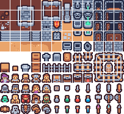
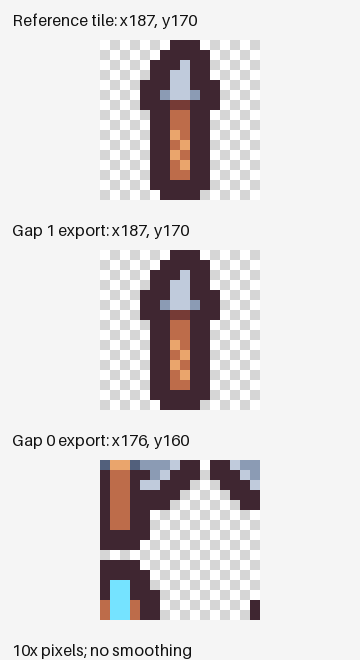

## 프레임 수 다음에 확인할 것

작은 타일셋을 자른 뒤 132개 프레임이 나왔지만, 이 숫자만으로 자르기가 맞았다고 판단할 수는 없습니다. 이번 입력에서는 가로·세로 간격을 1px로 두어도, 둘 다 0px로 두어도 프레임 수는 132개였습니다. 올바른 원본 타일과 출력의 픽셀값을 비교하면 각각 132개와 1개만 일치했습니다.

이 글은 AI 에이전트가 실제 Nerulio 화면을 조작하고 다운로드 파일을 검사해 작성한 기록입니다. 별도 사람의 육안 검수나 게임 엔진 실행 결과를 뜻하지 않습니다. 입력, 적용된 설정, 프레임별 검사 결과와 재현 코드를 함께 제공합니다.

## 입력과 네 번의 내보내기

입력은 Kenney Tiny Dungeon 1.0에 동봉된 203×186 PNG입니다. 패키지의 동봉 라이선스는 CC0입니다. 기준 격자는 셀 16×16, 바깥 여백 0, 가로·세로 간격 1px이며 가로 12개·세로 11개 셀로 구성됩니다. 원본과 같은 파일을 사용하려면 [입력 PNG](/assets/editorial/2026-11-14-sprite-grid/chromium/source.png)를 저장하세요.

2026년 11월 14일 한국시간에 Chromium 153.0.8010.12와 Firefox 155.0에서 두 조건씩, 총 네 번 내보냈습니다. 조건은 가로·세로 간격이 모두 1px인 기준 격자와 모두 0px인 대조 격자입니다. 셀 크기와 바깥 여백은 같습니다. 정지 타일을 다루므로 애니메이션은 ‘없음’을 선택했습니다. Pack & Export에서는 Phaser 프리셋과 형식을 선택했습니다.

스크립트는 파일 선택 화면부터 Studio의 입력·적용·다운로드 버튼까지 실제 UI를 거칩니다. 입력창의 숫자뿐 아니라 적용 후 프로젝트에 저장된 격자도 확인합니다. 예를 들어 0px 조건은 실제 적용값의 가로·세로 간격이 모두 0인지 검사한 뒤 내보냅니다.

## 개수·좌표·픽셀값을 따로 비교한 결과

| 브라우저 | 가로·세로 간격 | 출력 프레임 | 기준 좌표 일치 | 기준 타일 픽셀 일치 |
| --- | --- | ---: | ---: | ---: |
| Chromium 153 | 1px · 1px | 132 | 132 | 132 |
| Chromium 153 | 0px · 0px | 132 | 1 | 1 |
| Firefox 155 | 1px · 1px | 132 | 132 | 132 |
| Firefox 155 | 0px · 0px | 132 | 1 | 1 |

프레임 수가 같은 이유는 원본 너비 203px 안에 16px 셀이 두 조건 모두 12개 들어가기 때문입니다. 높이 186px에도 두 조건 모두 11개가 들어갑니다. 간격을 0으로 두면 오른쪽에 11px, 아래쪽에 10px이 남지만 셀 개수는 달라지지 않습니다.

셀의 시작 좌표는 바깥 여백이 0일 때 ‘열 번호 × (셀 너비 + 가로 간격)’, ‘행 번호 × (셀 높이 + 세로 간격)’입니다. 번호를 0부터 세면 마지막 셀은 열 11, 행 10입니다. 간격 1px의 시작점은 (187, 170), 간격 0px의 시작점은 (176, 160)이 됩니다. 마지막 셀에서 가로 11px·세로 10px 차이가 누적됩니다.

다운로드한 아틀라스의 JSON과 PNG를 Pillow 12.3.0으로 다시 읽어 각 프레임을 원래 캔버스에 복원했습니다. 잘라 낸 영역, 투명 여백과 원래 크기를 메타데이터로 반영한 뒤 기준 원본 영역과 비교했습니다. 완전히 투명한 픽셀의 RGB는 0으로 맞추고, 나머지 RGBA 샘플값은 그대로 비교했습니다. PNG 파일 전체의 바이트나 색관리·필터링까지 같다는 뜻은 아닙니다.

추가로 출력이 UI에서 선택한 자르기 영역을 보존했는지도 검사했습니다. 이 검사는 네 조건 모두 132개 전부 일치했습니다. 선택한 영역이 잘 내보내졌다는 것과 그 영역이 원본의 올바른 타일이라는 것은 각각 확인해야 합니다.

## 내 시트에서 확인하는 순서

1. [스프라이트 시트 자르기](/ko/sprite-slicer/)에서 원본 파일을 여세요. 가져오기 패널에서 셀 크기, 바깥 여백, 가로·세로 간격을 확인합니다.
2. 첫 셀과 마지막 열·행을 함께 보세요. 처음에는 맞아 보이다가 뒤로 갈수록 어긋나면 간격을 점검할 수 있습니다. 이 입력의 기준값은 셀 16×16, 여백 0, 간격 1×1입니다.
3. 정지 타일만 필요하면 애니메이션을 ‘없음’으로 지정하고 적용하세요. 내보낸 정지 아틀라스에 자동 애니메이션 파일이 추가되지 않는지도 확인합니다. 이 도구의 Godot SpriteFrames 내보내기는 애니메이션 태그가 필요하므로, 정지 타일맵을 만들 때는 [타일셋 작업실](/ko/game/tile-lab/)도 살펴보세요.
4. 내보낸 파일에서 크기와 좌표를 다시 확인하세요. 기준 조건의 [Phaser 형식 ZIP](/assets/editorial/2026-11-14-sprite-grid/chromium/gap-1-phaser.zip)과 0px 대조 조건의 [비교용 ZIP](/assets/editorial/2026-11-14-sprite-grid/chromium/gap-0-phaser.zip)을 제공합니다.

## 원본 시트를 Godot에서 다룰 때의 구분

Godot의 TileSetAtlasSource 문서는 셀 영역 크기, 격자의 시작 여백, 셀 사이 간격을 별도 속성으로 설명합니다. 이 실측의 **원본 시트**에 대응하는 값은 다음과 같습니다.

| 원본 시트 항목 | 이 입력의 값 | Godot 속성 |
| --- | --- | --- |
| 셀 영역 크기 | 16×16 | `texture_region_size` |
| 격자 시작 여백 | 0×0 | `margins` |
| 셀 사이 간격 | 1×1 | `separation` |

Pack & Export로 새로 배치한 PNG에는 새 아틀라스의 좌표를 사용해야 합니다. 원본의 1px 격자를 새 PNG에 그대로 적용하지 마세요. 이 글은 내보낸 파일을 재구성해 비교한 결과이며, Phaser나 Godot에서 로드하고 그리는 실행 검사는 수행하지 않았습니다.

## 재현과 적용 범위

저장소의 Node 의존성과 `requirements-test.txt`의 Python 의존성, Playwright 브라우저를 준비한 뒤 `python tools/editorial/measure-sprite-grid.py`를 실행하세요. Firefox 조건은 `--browser firefox`로 실행합니다. 새 결과는 `test-results/editorial-sprite-grid/`에 기록되며 공개한 기존 증거 파일을 덮어쓰지 않습니다. JSON에는 입력 해시, 소스 커밋, 실제 적용 격자, 프레임별 좌표와 비교 결과가 있습니다.

이 결과는 이 타일셋과 기록한 버전에서 얻은 값입니다. 다른 시트의 간격이나 애니메이션 구분을 대신 결정해 주지는 않습니다. 원본을 보존하고 프레임 수·좌표·출력을 함께 확인하세요. 크기 축소를 허용해 파일을 압축할 때는 [작은 PNG 압축 실측](/ko/ai/digest/small-transparent-png/)처럼 출력 해상도도 확인해야 합니다.
