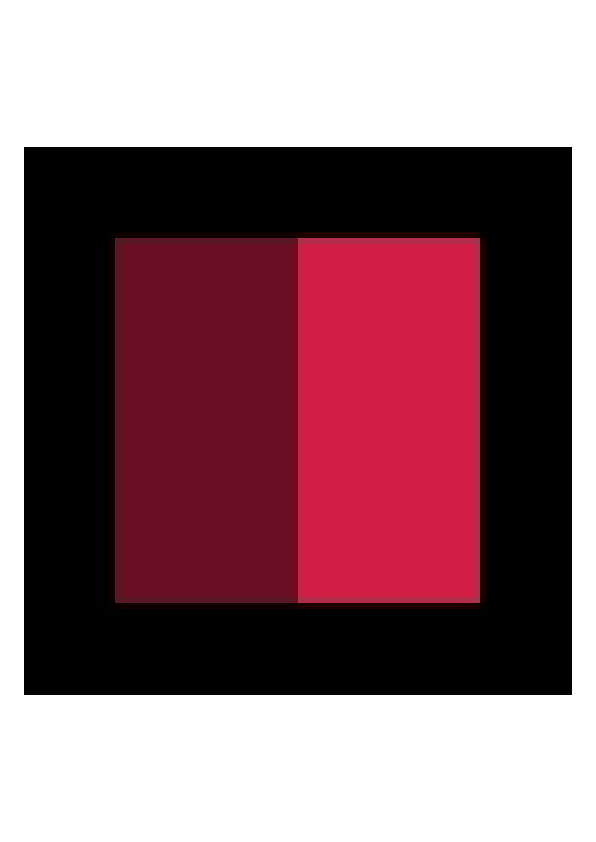

## Where the alpha disappeared

A transparent PNG and a lossless WebP with identical RGBA when decoded by Pillow produced different PDFs in Nerulio's image-to-PDF tool. Before the fix, the WebP's transparent border became black. Inside its PDF image object, all 7,168 non-opaque alpha samples had become opaque. The matching PNG kept its alpha. After the fix, the WebP's alpha mismatches fell to zero in both tested browsers.

These are 96 × 96 authored controls. The counts describe alpha samples, not a percentage of visual quality lost, and they do not rank file formats or converters. The useful check is the path from decoded input through the intermediate image encoder to the actual PDF.

## Four inputs and two deployed sources

We downloaded eight PDFs from the earlier deployed source `8889f53` and eight from fixed source `66c3515`. Each acquisition selected the real local file in the native picker and pressed the normal PDF export button. The tool ran without runtime interception or substituted output. The acquisition protocol was committed before the baseline; its LF-normalized hash matched between runs, and all four input files were byte-identical.

The transparent PNG/WebP pair contains 5,120 fully transparent pixels, 2,048 pixels at alpha 128 and 2,048 fully opaque pixels. The opaque WebP and JPG use the same small geometric pattern as negative controls. They are not photographs or private user files.

Both runs used Chromium 153.0.8010.12 and Firefox 155.0, default A4 paper and 24 pt margins. The exported PDF has one 595.28 × 841.89 pt page with a 96 × 96 image resource. The tool enlarges that image to fit the page; source-image alpha counts and page-render pixel counts are separate measurements. Build checks surrounded each download, and five served application modules were checked against their Git source before and after each browser run.

An AI agent operated the browsers, inspected the data and wrote this analysis. There was no human perceptual evaluation or printer trial. The [method record](/assets/editorial/2026-11-14-pdf-image-alpha/README.md) and original measurement files disclose the acquisition times, source revisions, protocol hash and environment observations.

## Every image alpha sample

We read every alpha sample from the PDF image's soft mask and compared it with the decoded input. In these specific objects, an absent mask meant an opaque image; no color-key mask was present. Each comparison covers 9,216 image samples.

| Browser | Input | Before mismatches | After mismatches |
| --- | --- | --- | --- |
| Chromium | Transparent PNG | 0 | 0 |
| Chromium | Transparent WebP | 7,168 | 0 |
| Firefox | Transparent PNG | 0 | 0 |
| Firefox | Transparent WebP | 7,168 | 0 |

The earlier WebP PDFs contained a JPEG image with a `DCTDecode` filter and no soft mask. The fixed WebP PDFs contain a PNG-derived image using `FlateDecode` with an `SMask` whose alpha samples match the source. The PNG control kept matching alpha in both states.

The opaque controls also matter: all four embedded JPG/WebP JPEG streams, across both browsers, were byte-identical between the earlier and fixed runs. That checks the unchanged path for these controls. It does not mean that an opaque input photograph is preserved losslessly; this tool still re-encodes that path as JPEG.

## Rendering on a white page

Below is the Chromium WebP PDF before the fix, independently rendered by Poppler at 72 dpi. The black area belongs to the embedded image; it is not the PDF page background.



The fixed PDF renders the transparent border against the white page, with a lighter half-alpha patch. The two illustration files are unchanged copies of the corresponding saved page renders.


At the source-coordinate sample `(8,8)`, the earlier WebP PDF rendered black `(0,0,0)` in both browsers; the fixed PDF rendered white `(255,255,255)`. At `(32,32)` in the half-alpha patch, Chromium changed from `(104,15,35)` to `(232,142,162)`. Firefox changed from `(105,16,36)` to `(233,143,163)`. These RGB observations describe the white-page render. The matching soft-mask samples establish that the fix retained alpha rather than merely painting a white background over it.

## The JPEG step

The earlier implementation chose PNG only when the input MIME type was `image/png`. Other decoded inputs, including transparent WebP, went through canvas JPEG encoding before PDF embedding. The WHATWG HTML serialization rules specify a black matte for image types without alpha. That behavior explains the dark border and half-alpha patch observed here.

The fixed implementation checks decoded transparency and uses PNG embedding for transparent inputs. The pdf-lib PNG embedder stores the alpha channel as a separate soft-mask image. Opaque JPG/WebP keep the existing JPEG path, so the correction does not force every image into PNG.

Matching alpha still does not establish matching RGB, hidden RGB, metadata or ICC profiles. Our [separate translucent-RGB study](/en/ai/digest/transparent-rgb-roundtrip/) measured small channel differences even when alpha stayed intact. Treat those properties separately when exact data preservation matters.

## Recheck the evidence

The [evidence ZIP](/assets/editorial/2026-11-14-pdf-image-alpha/pdf-image-alpha-evidence.zip) contains the inputs, sixteen PDFs, sixteen complete page renders, original measurements, paired analysis, protocol, licenses and a standalone verifier. With Python, Pillow, pypdf and `pdftoppm` available, extract the archive and run:

```text
python verify-pdf-image-alpha.py
```

The verifier checks the exact inventory and hashes, all alpha samples, PDF dimensions, recorded RGB points and all sixteen full render replays. It also repeats the four opaque JPEG-stream comparisons. It reads local evidence without requesting network data or modifying the package. New native captures can have different document hashes because of creation times and encoder versions; the README explains the separate historical-verification and new-acquisition paths.

Try the current [image-to-PDF tool](/en/jpg-to-pdf/) with a small transparent control before using a larger asset. Check its actual PDF output, including a half-transparent region. These measurements cover the disclosed 8-bit controls and default A4 workflow. They do not establish results for arbitrary images, HDR, 16-bit data, animation, other paper settings, print workflows, PDF/A or accessibility tagging.
