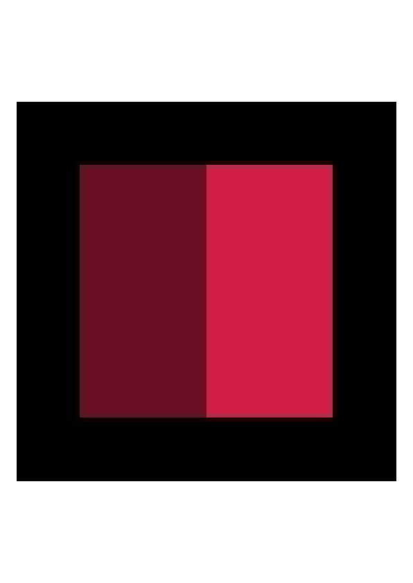

## PDF 안에서 사라진 투명도

Pillow로 디코딩한 RGBA가 같은 투명 PNG와 무손실 WebP를 Nerulio 이미지→PDF 도구에 넣었습니다. 수정 전에는 WebP의 투명한 테두리가 검게 보였습니다. PDF 안의 이미지 리소스를 읽어 보니 원본에서 불투명하지 않았던 7,168개 알파 값이 모두 불투명으로 바뀌었습니다. 같은 그림의 PNG는 알파를 유지했습니다. 수정 후에는 두 브라우저 모두 WebP의 알파 불일치가 0이 됐습니다.

96×96 크기의 직접 만든 시험 도형에서 나온 결과입니다. 7,168이라는 수는 알파 값이 달라진 픽셀 수이며, 화질 손실률이나 파일 형식의 순위가 아닙니다. 이 사례에서 확인할 부분은 입력을 디코딩한 뒤 어떤 중간 이미지 형식으로 바꾸고 PDF에 넣었는지입니다.

## 측정 조건과 입력 4종

기존 운영 소스 `8889f53`에서 PDF 8개, 수정된 운영 소스 `66c3515`에서 8개를 받았습니다. 실제 파일 선택 창으로 입력을 고르고 일반 PDF 저장 버튼을 눌렀습니다. 이 16회 취득에는 런타임 가로채기나 가짜 PDF 출력을 쓰지 않았습니다. 취득 코드는 수정 전 측정에 앞서 커밋으로 고정했습니다. 전후 실행의 프로토콜은 LF 줄바꿈으로 정규화한 해시가 같았고, 입력 4종도 바이트 단위로 같았습니다.

투명 PNG·WebP 쌍에는 알파 0인 픽셀 5,120개, 알파 128인 픽셀 2,048개, 알파 255인 픽셀 2,048개가 있습니다. 두 파일의 디코딩한 RGBA는 같습니다. 불투명 WebP와 JPG는 같은 작은 도형으로 만든 대조군입니다. 사진이나 개인 문서는 사용하지 않았습니다.

두 측정의 브라우저는 Chromium 153.0.8010.12와 Firefox 155.0입니다. 기본 A4와 24pt 여백을 사용했습니다. 결과 PDF는 595.28×841.89pt 페이지 한 장이며, 안에 들어 있는 이미지 리소스는 96×96입니다. 이미지는 페이지에 맞게 확대됩니다. 따라서 원본 이미지의 알파 개수와 페이지를 렌더링한 픽셀 수는 구분해야 합니다. 매 다운로드 전후에 운영 빌드를 확인했고, 브라우저별 실행 전후에는 서버가 제공한 응용 모듈 5개를 해당 Git 소스와 대조했습니다.

AI 에이전트가 브라우저 조작·자료 분석·작성을 수행했습니다. 별도 사람의 지각 평가나 인쇄 시험 결과는 아닙니다. [측정 방법 기록](/assets/editorial/2026-11-14-pdf-image-alpha/README.md)과 각 측정 JSON에 취득 시각, 소스 버전, 프로토콜 해시와 환경 관측값을 남겼습니다.

## 알파 값 9,216개 비교

PDF 이미지의 소프트 마스크를 디코딩해 원본 알파와 비교했습니다. 이 자료의 이미지에는 색상 키 마스크가 없었고, 소프트 마스크가 없는 경우 불투명 이미지로 처리됐습니다. 비교 단위는 이미지당 알파 값 9,216개입니다.

| 브라우저 | 입력 | 수정 전 불일치 | 수정 후 불일치 |
| --- | --- | --- | --- |
| Chromium | 투명 PNG | 0 | 0 |
| Chromium | 투명 WebP | 7,168 | 0 |
| Firefox | 투명 PNG | 0 | 0 |
| Firefox | 투명 WebP | 7,168 | 0 |

수정 전 WebP PDF의 이미지 필터는 `DCTDecode`였고 소프트 마스크가 없었습니다. 수정 후에는 PNG를 거친 `FlateDecode` 이미지와 `SMask`가 들어갔으며, 마스크의 알파 값이 원본과 모두 일치했습니다. PNG 대조군은 전후 모두 알파를 유지했습니다.

불투명 대조군도 확인했습니다. 두 브라우저에서 나온 JPG·WebP 이미지 스트림 4쌍은 전후 바이트 단위로 같았습니다. 이 입력들에서 기존 JPEG 처리 경로가 유지됐다는 근거입니다. 불투명 사진의 원본이 무손실로 보존된다는 뜻은 아닙니다. 해당 경로는 여전히 JPEG로 다시 인코딩합니다.

## 흰 페이지에서 보이는 차이

아래는 Chromium의 수정 전 WebP PDF를 Poppler로 72dpi 렌더링한 결과입니다. 검은 부분은 PDF 페이지 배경이 아니라, 삽입된 이미지 안에 생긴 영역입니다.



수정 후에는 투명한 테두리 사이로 흰 페이지가 보이고, 절반 투명한 붉은 패치도 밝아집니다. 두 예시 이미지는 실제로 보관한 페이지 렌더링 파일을 편집 없이 복사한 것입니다.


원본 좌표 `(8,8)`에 해당하는 지점은 수정 전 두 브라우저 모두 검정 `(0,0,0)`, 수정 후 흰색 `(255,255,255)`으로 렌더링됐습니다. 절반 투명한 패치의 `(32,32)` 지점은 Chromium에서 `(104,15,35)`→`(232,142,162)`, Firefox에서 `(105,16,36)`→`(233,143,163)`이었습니다. 이 RGB 값은 흰 페이지에 렌더링한 결과입니다. 앞서 마스크의 알파 값도 확인했으므로, 단순히 흰 배경을 덧칠해 검정을 가린 것과 구분할 수 있습니다.

## JPEG를 거친 변환 경로

기존 구현은 입력 MIME이 `image/png`일 때만 PNG 삽입을 선택했습니다. 투명 WebP를 포함한 나머지 입력은 캔버스에서 JPEG로 인코딩한 뒤 PDF에 넣었습니다. WHATWG HTML의 직렬화 규칙은 알파를 지원하지 않는 이미지 형식으로 저장할 때 검은 배경에 합성하도록 정합니다. 이번 출력의 검은 테두리와 어두운 반투명 패치는 이 동작과 맞습니다.

수정된 구현은 디코딩한 이미지에 투명이 있는지 확인해 PNG 삽입을 선택합니다. pdf-lib의 PNG 삽입기는 알파 채널을 별도의 소프트 마스크로 저장합니다. 불투명 JPG·WebP는 기존 JPEG 경로를 사용하므로 모든 입력을 PNG로 바꾸지는 않습니다.

알파가 일치해도 RGB·보이지 않는 RGB·원본 메타데이터·ICC 프로필이 모두 같다는 뜻은 아닙니다. [반투명 RGB를 따로 비교한 실측](/ko/ai/digest/transparent-rgb-roundtrip/)에서는 알파가 유지돼도 작은 채널 차이가 남았습니다. 데이터 보존이 목적이라면 각 항목을 나누어 확인해야 합니다.

## 파일과 숫자 다시 검증하기

[실측 자료 ZIP](/assets/editorial/2026-11-14-pdf-image-alpha/pdf-image-alpha-evidence.zip)에 입력, PDF 16개, 전체 페이지 렌더링 16개, 원래 측정 기록, 비교 분석, 프로토콜, 라이선스와 독립 실행 검증기를 넣었습니다. Python·Pillow·pypdf와 `pdftoppm`이 준비된 환경에서 압축을 풀고 다음을 실행하세요.

```text
python verify-pdf-image-alpha.py
```

검증기는 파일 목록·해시, 알파 값 전체, PDF 크기, RGB 표본과 페이지 렌더링 16개 전체를 다시 확인합니다. 불투명 JPEG 스트림 4쌍 비교도 반복합니다. 네트워크에서 자료를 받거나 증거 파일을 수정하지 않습니다. 새로 취득한 PDF는 생성 시각이나 인코더 버전 때문에 전체 파일 해시가 달라질 수 있습니다. README에 과거 자료 검증과 새 브라우저 취득 절차를 구분해 적었습니다.

현재 [이미지→PDF 도구](/ko/jpg-to-pdf/)에서도 큰 에셋을 넣기 전에 작은 투명 입력으로 실제 PDF를 확인할 수 있습니다. 완전히 투명한 부분과 반투명한 부분을 함께 살펴보세요. 이 실측은 공개한 8비트 도형과 기본 A4 흐름에 한정됩니다. 임의의 이미지, HDR, 16비트 데이터, 애니메이션, 다른 용지 설정, 인쇄, PDF/A 또는 접근성 태그까지 검증한 결과는 아닙니다.
